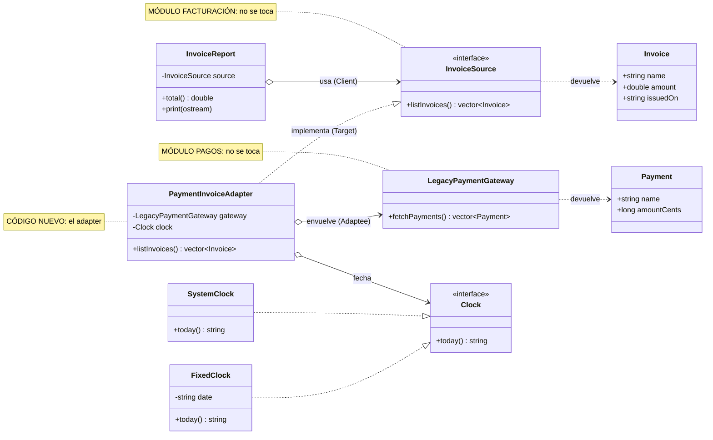

# Patrón Adapter — C++ y Python

Repositorio didáctico del patrón de diseño **Adapter** con un caso de finanzas. Hay dos
módulos existentes que **no se pueden modificar** y que hablan "idiomas" distintos; el
adapter es la única pieza nueva que los hace trabajar juntos. Cada ejemplo está
implementado en **C++17** y en **Python 3.9+**, con pruebas.

## El problema

| Módulo | Qué maneja | Monto |
| :-- | :-- | :-- |
| **Pagos** (heredado) | nombre + monto | centavos enteros, sin fecha |
| **Facturación** (moderno) | nombre + monto + **fecha de elaboración** | unidades decimales, fecha obligatoria |

El cliente de facturación (`InvoiceReport`) sólo sabe consumir un `InvoiceSource`. Para
alimentarlo con los pagos heredados se escribe `PaymentInvoiceAdapter`, que implementa
`InvoiceSource` y por dentro llama a `LegacyPaymentGateway`.

## Roles del patrón

| Rol | C++ | Python |
| :-- | :-- | :-- |
| Target | `invoicing/InvoiceSource.hpp` | `invoicing/invoice_source.py` |
| Client | `invoicing/InvoiceReport.hpp` | `invoicing/invoice_source.py` |
| Adaptee | `payments/LegacyPaymentGateway.*` | `payments/legacy_payment_gateway.py` |
| **Adapter** | `adapter/PaymentInvoiceAdapter.hpp` + `Clock.hpp` | `adapter/payment_invoice_adapter.py` |

Diagrama de clases completo (con una tabla de lo que traduce el adapter): [`docs/diagrama_clases.md`](docs/diagrama_clases.md).



## Origen del patrón

Adapter fue catalogado por la "Banda de los Cuatro" (*Gang of Four*, GoF) en el libro
*Design Patterns: Elements of Reusable Object-Oriented Software* (Addison-Wesley, 1994).
Es uno de sus 7 patrones estructurales y también se conoce como *Wrapper*.

- Erich Gamma
- Richard Helm
- Ralph Johnson
- John Vlissides

## Estructura de carpetas

```
.
├── README.md
├── docs/                      Documentación: diagrama de clases en Mermaid
├── cpp/
│   ├── Makefile               Objetivos: all, run, test, clean
│   ├── include/
│   │   ├── payments/          Módulo de pagos heredado (no se modifica)
│   │   ├── invoicing/         Módulo de facturación: Target y Client (no se modifica)
│   │   └── adapter/           Código nuevo: adapter y reloj inyectable
│   ├── src/                   Implementaciones (.cpp) y main de demostración
│   └── tests/                 Pruebas del adapter
└── python/
    ├── main.py                Demostración
    ├── payments/              Módulo de pagos heredado (no se modifica)
    ├── invoicing/             Módulo de facturación (no se modifica)
    ├── adapter/               Código nuevo: el adapter
    └── tests/                 Pruebas del adapter (unittest)
```

## Ejecutar

```bash
# C++ (g++ con soporte C++17)
cd cpp && make test && make run

# Python (sin dependencias externas)
cd python && python3 -m unittest discover -s tests -t . && python3 main.py
```

Compilar las pruebas de C++ a mano (desde `cpp/`, equivale a `make test`):

```bash
g++ -std=c++17 -Wall -Wextra -Iinclude tests/test_adapter.cpp src/LegacyPaymentGateway.cpp -o build/test && ./build/test
```

> Si `build/` no existe, créala antes con `mkdir -p build`.

## Ejercicio: recrear el adapter desde cero (~15 min)

1. Borra `cpp/include/adapter/` (o `python/adapter/`) y `tests/`.
2. Lee `InvoiceSource` y `LegacyPaymentGateway`: son tus dos extremos.
3. Escribe primero una prueba: *"el primer pago de 125050 centavos se factura como 1250.50"*.
4. Crea la clase que **implementa** `InvoiceSource` y **guarda** una referencia al gateway.
5. En `listInvoices()` recorre los pagos y convierte cada uno en `Invoice`.
6. Resuelve la fecha: inyecta un reloj para poder probar con una fecha fija.
7. Maneja el caso especial: los reembolsos no se facturan.
8. Cambia el reloj a `FixedClock` y verifica que las pruebas pasan.
